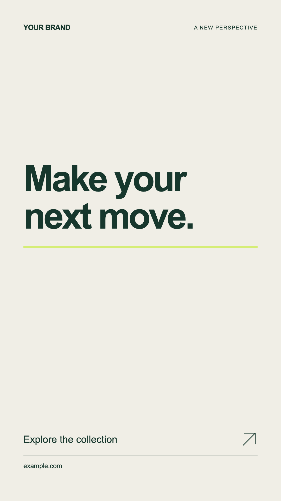

# Brand Motion Graphics Kit

Editable Remotion endings and overlays for campaigns, with brand-controlled typography, colors, CTA and safe margins.

Open the prepared workspace, or install Node.js 22+, run `npm ci` and `npm run studio`. Upload a brand guideline to your AI agent before customization and give it MASTER_PROMPT.md. A workspace launch does not authorize paid media generation or publishing.

## Components

| Composition | Size | Use |
|---|---|---|
| BrandEnding | 1080 × 1920 | Vertical campaign ending |
| BrandEndingFeed | 1080 × 1350 | Feed ending |
| BrandEndingLandscape | 1920 × 1080 | Landscape ending |
| BrandOverlay | 1080 × 1920 | Transparent lower-third overlay |

All defaults are generic. Edit `brand.json`, put owned logo/font files under `public/`, and render with `npm run render`. Use `npx remotion render src/index.tsx BrandEndingFeed out/feed.mp4 --props=brand.json` for another size. `quietMotion` disables entrance motion. Still preview: `npm run still`. For an alpha overlay, use a supported transparent output such as a PNG sequence or ProRes 4444; an ordinary H.264 MP4 is not transparent.

The kit does not generate or edit a whole commercial automatically. It supplies reusable motion components and a production/QA workflow for an AI host. Brand-specific fonts require a local licensed font and deterministic font loading before render; the default is Arial/system sans-serif. Existing client footage and logos are excluded.

`npm run check` checks TypeScript. Read QUALITY_CHECKS.md before approving a render. Successful rendering does not verify brand fidelity or audio. Source code is MIT; Remotion and other dependencies retain their own licenses. Check [Remotion licensing](https://www.remotion.dev/license) for your use.

## Sample preview

